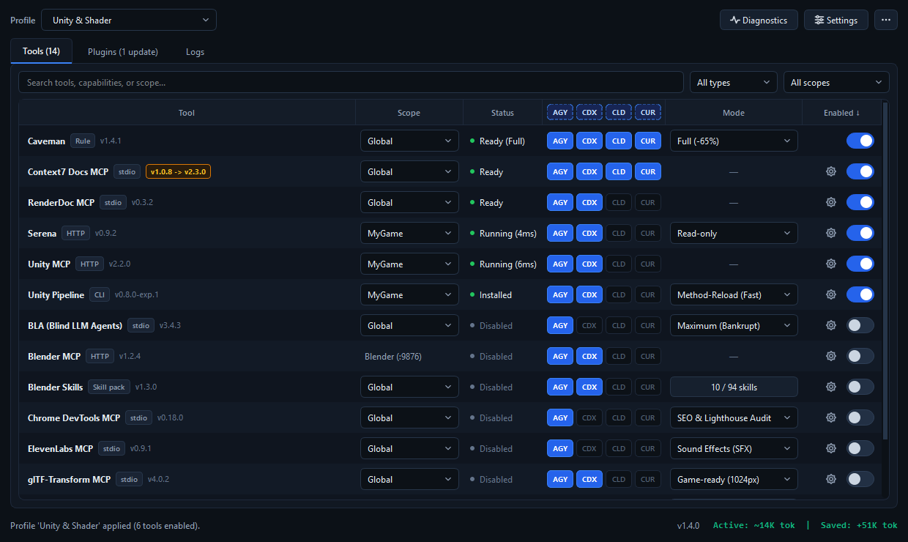

<p align="center">
  
</p>

<h1 align="center">AIconomy</h1>

<p align="center">
  A minimalist native Windows desktop control center (PySide6 / Qt 6) for managing MCP servers, AI coding client configs, skill packs, local GPU/3D bridges, and context token budgets from one place.
</p>

<p align="center">
  <a href="https://github.com/DoranPierst/AIconomy/releases/latest"></a>
  
  
  <a href="LICENSE"></a>
</p>

<p align="center">
  
</p>

---

## Download (Windows 10 / 11)

No Python installation required:

1. Download **`AIconomy.exe`** from the [**Latest Release**](https://github.com/DoranPierst/AIconomy/releases/latest).
2. Double-click `AIconomy.exe` to launch.
3. Click the version badge in the footer (or **More menu -> Check for App Updates**) anytime to pull future GitHub releases automatically.

> **Windows SmartScreen note:** `AIconomy.exe` is currently unsigned, so Windows Defender SmartScreen may show a warning on first run (**More info** -> **Run anyway**). You can also inspect the source and build the executable locally with `build_exe.bat`.

---

## Key Features

- **Unified Per-Client MCP Matrix (`AGY / CDX / CLD / CUR`):** Enable or disable MCP servers, CLI tools, rules, and skill packs per AI client (**Google Antigravity**, **OpenAI Codex**, **Claude Code**, **Cursor**), or bulk-toggle entire columns from the table header.
- **Built-In & Custom Profiles:** Switch tool sets with a single top-bar **Profile** dropdown (`Unity & Shader`, `3D Assets`, `Web`, `Minimal`, or your own saved profiles) with JSON export/import support.
- **Token Schema Budget Tracker:** Tracks active MCP tool schema footprint (`Active` vs `Saved` tokens) in real time as you enable or disable tools.
- **Live Health, Process & Port Monitor:** Verifies real visible host windows (`IsWindowVisible`) and local TCP ports (`:9121`, `:8080`, `:9876`, `:8790`), safely starts/stops only managed bridges, and offers one-click minimized host launch for Unity, Blender, RenderDoc, or TRELLIS.
- **Diagnostics Center:** Run end-to-end MCP handshakes (`initialize`, Blender `get_scene_info`, and `stdio` JSON-RPC probes) even when AI IDEs are closed, inspect stuck ports, and copy structured diagnostic reports.
- **Plugin Updates & GitHub Installer:** Check PyPI / npm / GitHub updates in parallel, update tools individually or in batch, and inspect/add custom MCP servers from any GitHub repository URL.
- **Persistent SQLite Logs & AI Troubleshooting Export:** Search and filter logs (`ERR`, `WARN`, `INFO`, `DBG`) and copy selected entries with affected tool metadata into a structured prompt for any AI assistant.
- **100% English & Turkish UI:** Full live language switching with Windows OS locale auto-detection, plus Dark and Light themes and optional minimize-to-tray behavior.

---

## Files AIconomy Modifies

When you toggle tools or change scopes, AIconomy updates **only its own managed entries** inside the AI client configs below using atomic writes. A `.bak` backup is written before any modification, and untouched files are never rewritten:

| Client | Configuration File(s) |
|---|---|
| Google Antigravity | `%USERPROFILE%\.gemini\config\mcp_config.json` |
| OpenAI Codex | `%USERPROFILE%\.codex\config.toml` (marked `# >>> BEGIN AICONOMY >>>` block) |
| Claude Code | `%USERPROFILE%\.claude.json`, `<project>\.mcp.json` |
| Cursor | `%USERPROFILE%\.cursor\mcp.json`, `<project>\.cursor\mcp.json` |

### Data Storage & Portable Mode

- Application state (`aiconomy-state.json`), SQLite logs (`aiconomy.db`), and encrypted API keys (`aiconomy-vault.dpapi.json`) are stored in `%LOCALAPPDATA%\AIconomy\data`.
- Existing files from earlier versions (`hub_state.json`, `ai_hub_logs.db`, `vault.dpapi.json`) are migrated non-destructively on first launch.
- To run in **portable mode**, create an empty `portable.txt` file next to `AIconomy.exe` to store data in a local `data\` folder beside the executable.

### Security & API Keys

- API keys entered in **Settings -> API Keys** are encrypted at rest on disk using Windows DPAPI (`CryptProtectData`, scoped to the current Windows user account).
- **Plaintext-on-sync notice:** When a tool that requires an API key is enabled and synced to an AI client, that key is written **in plain text** into the enabled client's MCP config file listed above, because MCP clients read environment variables directly from those config files.

---

## Running from Source / Building Standalone EXE

Requires **Windows 10/11**, **Python 3.11+**, and [**uv**](https://docs.astral.sh/uv/).

```powershell
uv sync
uv run python main.py
```

- Double-click `start.bat` to launch from source without a console window.
- Double-click `build_exe.bat` to build a standalone `dist\AIconomy.exe` via PyInstaller.

---

## License

Released under the [MIT License](LICENSE). See [CHANGELOG.md](CHANGELOG.md) for release history.
