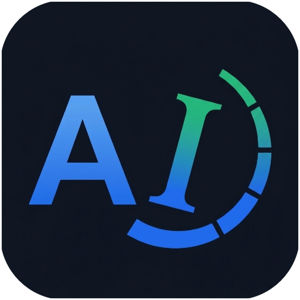

<p align="center">
  
</p>

# AIconomy

A native Windows desktop control center (`PySide6` / Qt 6) for managing MCP servers, AI coding assistants (**Google Antigravity**, **OpenAI Codex**, **Claude Code**, **Cursor**), local GPU/3D tools (**Blender**, **Unity**, **RenderDoc**, **Trellis**), and token schema budgets from one unified interface.

---

## ⬇️ Download (Windows)

No Python or setup required:
1. Download **`AIconomy.exe`** from the [**Latest Release**](https://github.com/DoranPierst/AIconomy/releases/latest).
2. Double-click `AIconomy.exe` to run (all settings are stored locally in `data/` next to the `.exe`).
3. Use the in-app **App Update** button anytime to pull future releases automatically.

---

## ✨ Key Features

- **8 Built-in Languages:** 🇹🇷 Türkçe · 🇺🇸 English · 🇩🇪 Deutsch · 🇫🇷 Français · 🇪🇸 Español · 🇷🇺 Русский · 🇯🇵 日本語 · 🇨🇳 中文 (instant live switching + OS locale auto-detection).
- **Per-Client & Per-Project MCP Matrix (`AGY / CDX / CLD / CUR`):** Toggle any tool per AI client or bulk-toggle entire columns from the table header. Supports global & project-scoped `.mcp.json` / `.cursor/mcp.json` / `config.toml` / `mcp_config.json` with automatic `.bak` backups.
- **Real-Time Process, Window & Port Watcher (3s):** Verifies real visible GUI windows (`IsWindowVisible`) + TCP sockets (`:9121`, `:8080`, `:9876`, `:8790`), auto-heals dropped HTTP MCP bridges, and detects headless/zombie processes.
- **🔌 End-to-End Connection Tester:** Tests HTTP MCP (`initialize`), Blender (`get_scene_info`), and `stdio` MCP handshakes directly — even when Antigravity or other AI IDEs are closed.
- **Host-App Dependency Launcher:** Detects when an enabled tool's host program (`Unity`, `Blender`, `RenderDoc`, `Trellis`) is closed and offers 1-click headless/minimized startup.
- **Custom Named Presets (`💾 My Presets`) & Multi-Select Profiles:** Save named configurations for different projects and switch back anytime.
- **Windows DPAPI Encrypted Vault:** Stores API keys securely using Windows `CryptProtectData` (never plaintext).

---

## 🛠️ For Developers (Running from Source / Building EXE)

```powershell
uv sync
uv run python main.py
```

Or double-click `start.bat` to launch without a console window, and `build_exe.bat` to build a standalone `dist/AIconomy.exe`.
